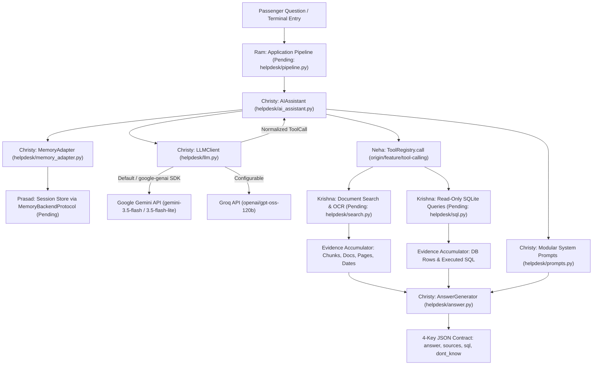

# 🚆 Railway Passenger Help Desk

**Team 5 · GenAI Nexus Fellowship · Module 2 Capstone**

An evidence-grounded, tool-augmented Python terminal AI assistant for Indian Railways passenger inquiries—combining official Railway Board circulars, IRCTC refund rules, and a 2016 SQLite railway timetable snapshot under a strict four-field structured response contract.

[](https://www.python.org/)
[](https://pypi.org/project/google-genai/)
[](https://groq.com/)
[-0A9EDC?logo=pytest&logoColor=white)](https://docs.pytest.org/)
[](https://github.com/chxisty/genai-nexus-capstone-team-5)

> **Scope & Status Note:** This repository is an active five-member collaborative capstone. On branch `feature/christy-ai-assistant`, **Member 1's AI Assistant & LLM Integration layer** is fully implemented, unit-tested (50 mocked tests passing), and live-verified against Groq (`openai/gpt-oss-120b`) and Google Gemini (`gemini-3.5-flash` / `gemini-3.5-flash-lite`). **Member 3's Tool Registry & Schemas** exist on `origin/feature/tool-calling`. Modules for **Members 2, 4, and 5** are pending branch integration, so the full end-to-end team application has not yet undergone final capstone evaluation.

---

## 📋 Table of Contents

1. [Project Overview & Problem Statement](#1-project-overview--problem-statement)
2. [Project Objectives](#2-project-objectives)
3. [Key Features](#3-key-features)
4. [System Architecture](#4-system-architecture)
5. [Technology Stack](#5-technology-stack)
6. [Detailed Module Descriptions](#6-detailed-module-descriptions)
7. [LLM Integration & Supported Providers](#7-llm-integration--supported-providers)
8. [Function / Tool-Calling Workflow](#8-function--tool-calling-workflow)
9. [RAG & Document Retrieval Workflow](#9-rag--document-retrieval-workflow)
10. [SQLite Database Integration](#10-sqlite-database-integration)
11. [Conversation Memory & Session Management](#11-conversation-memory--session-management)
12. [Grounded Answer Generation & Source Citations](#12-grounded-answer-generation--source-citations)
13. [Project Directory Structure](#13-project-directory-structure)
14. [Installation & Setup Instructions](#14-installation--setup-instructions)
15. [Environment Variable Configuration](#15-environment-variable-configuration)
16. [How to Run the Application](#16-how-to-run-the-application)
17. [How to Execute Automated Tests](#17-how-to-execute-automated-tests)
18. [Live API Verification & Testing Results](#18-live-api-verification--testing-results)
19. [Team Members & Responsibilities](#19-team-members--responsibilities)
20. [Current Implementation Status & Pending Integration](#20-current-implementation-status--pending-integration)
21. [Future Enhancements](#21-future-enhancements)
22. [Fellowship Information & Disclaimer](#22-fellowship-information--disclaimer)

---

## 1. Project Overview & Problem Statement

Railway passengers regularly ask high-stakes questions about cancellation charges, Tatkal verification, advance reservation periods, chart preparation timings, and train routes. Finding accurate answers manually is error-prone because official guidance is scattered across:

- **Multi-format regulatory documents (7 files):** IRCTC refund/TDR rules (`PDF`), Indian Railways 2015 refund table (`HTML`), PIB Reform Express press release (`HTML`), and four Railway Board Commercial Circulars—several of which contain **scanned PDF pages** requiring OCR.
- **Conflicting rule revisions:** Newer Railway Board circulars and Gazette notifications supersede older 2015 provisions, and train-specific rules (e.g., Vande Bharat Sleeper Express) override general cancellation slabs.
- **Exact identifiers & relational schedules:** Train numbers (`12430`, `12951`), station codes (`NDLS`, `JP`, `UDZ`), and overnight route durations live in a relational SQLite database (`rail_timetable.db` 2016 snapshot) rather than prose documents.
- **Out-of-scope requests:** Real-time running status, ticket fares, PNR predictions, and database mutation requests must be honestly declined rather than hallucinated.

The **Railway Passenger Help Desk** solves this by routing passenger questions through a unified `ask(question)` interface that retrieves verified document chunks, queries read-only SQLite timetable data through validated tools, tracks multi-turn context, and returns a strictly validated four-key JSON payload (`answer`, `sources`, `sql`, `dont_know`).

---

## 2. Project Objectives

1. **Zero-Hallucination Grounding:** Answer passenger questions strictly from retrieved official documents and read-only SQLite results, returning `dont_know: true` whenever evidence is insufficient or out of scope.
2. **Accurate Citation & SQL Transparency:** Cite exact document filenames and page numbers (`null` for HTML documents) and return the exact `SELECT` SQL statement executed for database-backed responses.
3. **Rule Precedence & Temporal Awareness:** Prefer newer Railway Board circulars over superseded rules, apply train-specific overrides accurately, and distinguish the 2016 timetable snapshot from live train operations.
4. **Multi-Provider Resilience:** Support both Google Gemini (`google-genai` SDK) and Groq behind a single normalized `LLMClient` interface with deterministic retries, error mapping, and secret redaction.
5. **Modular Team Boundaries:** Decouple AI orchestration, tool validation, DB/RAG retrieval, session memory, and CLI evaluation behind clean Python protocols for smooth five-member integration.

---

## 3. Key Features

### Implemented & Verified (Member 1 — `feature/christy-ai-assistant`)
- **Dual-Provider LLM Client (`helpdesk/llm.py`):** Unified `LLMClient`, `LLMResponse`, and `ToolCall` abstractions supporting Google Gemini (migrated to official `google-genai` SDK, default `gemini-3.5-flash`, verified live with `gemini-3.5-flash` & `gemini-3.5-flash-lite`) and Groq (`openai/gpt-oss-120b`), plus `auto` selection mode.
- **Gemini 3.x Multi-Turn Compatibility:** Automatic caching and replay of Gemini 3.x `thought_signature` bytes by `tool_call_id` plus `FunctionResponse.id` matching and filtering of internal `part.thought` reasoning blocks.
- **Resilient Error Handling & Security:** Exponential backoff with jitter on `429` rate limits, timeouts (`504` / `httpx` timeouts), and network/5xx errors; immediate fail-fast on auth errors; automatic `[REDACTED]` masking of API keys in logs and exception messages.
- **Modular Grounded Prompts (`helpdesk/prompts.py`):** Composable policy blocks enforcing evidence-only answers, circular date precedence, train-specific rule priority, 2016 timetable scope, and zero leakage of sample question answers.
- **Deterministic Answer Guardrails (`helpdesk/answer.py`):** Post-generation validation filtering `(doc, page)` citations strictly against retrieved evidence allowlists, normalizing HTML page numbers to `null`, locking `sql` to real executed SQL only, and blocking ungrounded factual replies.
- **Multi-Step Tool Orchestration (`helpdesk/ai_assistant.py`):** Iterative tool-calling loop compatible with Neha's `ToolRegistry.call()` (`{"status": "success"|"error", "result": ...}`) as well as `.execute()` and callable interfaces, distinguishing search strings (e.g., `station_search`'s `"query"`) from executed SQL.
- **Token-Aware Memory Adapter (`helpdesk/memory_adapter.py`):** `MemoryBackendProtocol` adapter for Prasad's session store with missing-session safety, message limits, token-budget truncation, atomic preservation of `assistant(tool_calls)` + `tool` pairs, and an ephemeral `InMemorySessionMock` stub for isolated testing.

### Available on Teammate Branch (`origin/feature/tool-calling`)
- **Tool Schemas & Registry (`tools/`):** OpenAI-compatible `TOOL_SCHEMAS` (`station_search`, `train_search`, `train_details`, `route_lookup`) and `ToolRegistry` with argument validation and mock railway tools by Neha Santhosh.

---

## 4. System Architecture



---

## 5. Technology Stack

| Layer | Technology / Library | Purpose |
| :--- | :--- | :--- |
| **Language** | Python `3.12+` (Capstone baseline `3.10+`) | Core terminal application and type-annotated modules |
| **Gemini SDK** | `google-genai >= 1.0.0` (`3.1.0` tested) | Official Google GenAI SDK (`models.generate_content`, tool declarations, JSON mode) |
| **Groq SDK** | `groq >= 1.7.0` | Fast inference provider (`openai/gpt-oss-120b`) with OpenAI-compatible tool calling |
| **Configuration** | `python-dotenv >= 1.0.0` | Loads API keys and model config safely from local `.env` |
| **Validation** | `pydantic >= 2.0.0` | Data modeling and validation alignment across the project stack |
| **Database** | Python `sqlite3` (read-only URI mode) | Target engine for querying `rail_timetable.db` (Member 2 scope) |
| **Testing** | `pytest >= 8.0.0` (`9.2.0` tested) | Automated unit testing with mocked SDKs, tools, and memory backends |

---

## 6. Detailed Module Descriptions

### Member 1 Modules (`feature/christy-ai-assistant` — Implemented)

| Module | Key Classes & Functions | Responsibility |
| :--- | :--- | :--- |
| [`helpdesk/__init__.py`](helpdesk/__init__.py) | Package exports | Exposes Member 1 classes, protocols, prompt builders, and exception types cleanly without importing pending teammate files. |
| [`helpdesk/llm.py`](helpdesk/llm.py) | `LLMConfig`, `LLMClient`, `LLMResponse`, `ToolCall`, `extract_json_object`, `redact_secrets`, `LLMError` hierarchy | Multi-provider Gemini (`google-genai`) and Groq client, schema/message translation, Gemini 3.x `thought_signature` caching, retry with exponential backoff + jitter, and secret masking. |
| [`helpdesk/prompts.py`](helpdesk/prompts.py) | `build_assistant_system_prompt`, `build_answer_system_prompt`, `format_document_evidence`, `format_database_evidence`, `format_conversation_context`, `build_grounded_answer_messages` | Composes reusable prompt blocks enforcing evidence grounding, circular date/train precedence, 2016 snapshot boundaries, and refusal behavior. |
| [`helpdesk/answer.py`](helpdesk/answer.py) | `AnswerGenerator`, `GroundedAnswer`, `SourceCitation`, `extract_allowed_sources`, `normalize_sql_value` | Synthesizes and deterministically validates the 4-key response (`answer`, `sources`, `sql`, `dont_know`), filters hallucinated citations, forces HTML `page: null`, and locks `sql`. |
| [`helpdesk/memory_adapter.py`](helpdesk/memory_adapter.py) | `MemoryAdapter`, `MemoryBackendProtocol`, `InMemorySessionMock`, `estimate_message_tokens` | Adapts Prasad's session backend (with duck-typed method support), manages session creation/clearing, enforces message & token budgets, and groups `assistant(tool_calls)` + `tool` blocks atomically. |
| [`helpdesk/ai_assistant.py`](helpdesk/ai_assistant.py) | `AIAssistant`, `ToolExecutorProtocol`, `ToolRegistryProtocol`, `_EvidenceAccumulator`, `_collect_evidence_from_tool_result` | Coordinates memory retrieval, multi-step LLM tool-calling loops, safe tool dispatch, evidence extraction, ungrounded-claim blocking, and grounded answer generation. |

### Teammate Modules (Tracked Outside `feature/christy-ai-assistant`)

| Module | Owner | Status |
| :--- | :--- | :--- |
| `tools/schemas.py`, `tools/registry.py`, `tools/railway_tools.py` | Neha Santhosh | Implemented with mock functions on `origin/feature/tool-calling` (`0c63ac3`) |
| `helpdesk/ingest.py`, `helpdesk/search.py`, `helpdesk/sql.py` | Krishna Vinod | Pending branch push / integration |
| Session & conversation store (`MemoryBackendProtocol`) | Prasad Tribhuvan | Pending branch push / integration |
| `helpdesk/pipeline.py`, `ask.py`, `run_questions.py`, `build_index.py`, `eval/` | Narisetti Venkata Ram Manikanta | Pending branch push / integration |

---

## 7. LLM Integration & Supported Providers

[`LLMClient`](helpdesk/llm.py) normalizes Groq and Google Gemini behind one common interface:

| Dimension | Google Gemini (Default) | Groq (Configurable Alternative) |
| :--- | :--- | :--- |
| **SDK** | `google-genai` (`genai.Client` → `models.generate_content`) | `groq` (`Groq` → `chat.completions.create`) |
| **Default Model** | `gemini-3.5-flash` *(verified live; `gemini-3.5-flash-lite` also verified live)* | `openai/gpt-oss-120b` *(verified live)* |
| **System Prompt** | Extracted into `GenerateContentConfig(system_instruction=...)` | Passed as `{"role": "system", ...}` message |
| **Tool Schemas** | Converted recursively to `types.Tool` / `types.FunctionDeclaration` | Passed directly as OpenAI-style `tools` list |
| **Tool Turns** | Converted to `Content(role="model" / "user")` with `thought_signature` & `FunctionResponse.id` | Sent as `assistant(tool_calls)` + `role="tool"` messages |
| **JSON Mode** | `response_mime_type="application/json"` when `tools` is absent | `response_format={"type": "json_object"}` when `tools` is absent |

### Provider Selection Policy
- `LLM_PROVIDER=gemini` *(default if unset)*: strictly uses Google Gemini (aligned with automated capstone evaluation).
- `LLM_PROVIDER=groq`: strictly uses Groq (`openai/gpt-oss-120b`), raising `LLMAuthError` if `GROQ_API_KEY` is missing without silently switching providers.
- `LLM_PROVIDER=auto`: selects Gemini if `GEMINI_API_KEY` is configured, falling back to Groq if only `GROQ_API_KEY` is configured.

---

## 8. Function / Tool-Calling Workflow

1. **Schema Preparation:** OpenAI-format tool definitions (such as Neha's `TOOL_SCHEMAS`) are passed to [`AIAssistant`](helpdesk/ai_assistant.py) and translated automatically when using Gemini.
2. **Reasoning Loop (`max_tool_steps = 5`):** `AIAssistant.process_question()` calls `LLMClient.chat(messages, tools=...)`.
3. **Safe Dispatch (`_invoke_tool`):** If the LLM emits `ToolCall` objects, `AIAssistant` dispatches each call via `ToolRegistry.call(name, arguments)` (or `.execute()` / callable), catching exceptions safely so tool errors become structured feedback rather than crashes.
4. **Envelope Unwrapping (`_collect_evidence_from_tool_result`):**
   - Unwraps Neha's `{"status": "success", "tool": ..., "result": {...}}` and handles `"status": "error"` envelopes.
   - Separates document chunks (`chunks`, `documents`, or chunk-shaped `matches`/`results`) from structured DB outputs (`rows`, `trains`, `stops`, station `matches`).
   - Ignores non-SQL `"query"` text (such as `station_search`'s `{"query": "New Delhi"}`), recording only real `SELECT` / `WITH` SQL strings.
5. **Multi-Turn / Multi-Tool Support:** Tool responses are fed back to the LLM so hybrid questions (e.g., train departure time + cancellation charge) can invoke both database and document tools before synthesis.

---

## 9. RAG & Document Retrieval Workflow

The official capstone data pack (`data/`, gitignored locally) contains 7 regulatory sources:

- `indianrail_refund_rules_2015.html` *(2015 refund table; HTML → `page: null`)*
- `irctc_refund_rules_jan2026.pdf` *(11-page IRCTC refund & TDR rules)*
- `rb_cc10_2024_advance_reservation.pdf` *(60-day advance booking circular; scanned PDF)*
- `rb_cc08_2025_tatkal.pdf` *(Tatkal Aadhaar authentication circular; scanned Hindi pages)*
- `rb_cc10_2025_reservation_charts.pdf` *(First reservation chart preparation; scanned PDF)*
- `rb_cc08_2026_vande_bharat_sleeper_refund.pdf` *(Vande Bharat Sleeper circular + Gazette `G.S.R. 41(E)`)*
- `pib_2026-03-24_reform_express.html` *(PIB Reform Express release; HTML → `page: null`)*

**Team Division:**
- **Krishna Vinod (Pending):** Owns `helpdesk/ingest.py` (page-by-page parsing + OCR for scanned PDFs) and `helpdesk/search.py` (hybrid semantic + exact-code retrieval returning chunks with `doc`, `page`, `date`, and `text`).
- **Christy Marrya George (Implemented):** Consumes retrieved chunks in [`prompts.py`](helpdesk/prompts.py) and [`answer.py`](helpdesk/answer.py), instructing the LLM to resolve rule conflicts using document dates (`date=...`) and train-specific overrides while validating every citation against the retrieved allowlist.

---

## 10. SQLite Database Integration

The capstone timetable database (`rail_timetable.db`) is a static **2016 CC0 snapshot** containing:

| Table / View | Rows | Purpose |
| :--- | :---: | :--- |
| `stations` | 8,990 | Station codes, names, states, zones, coordinates |
| `train_types` | 16 | Type code mappings (`Raj`, `Shtb`, `SF`, etc.) |
| `trains` | 5,208 | Train numbers, names, endpoints, durations, distances, class flags |
| `schedules` | 417,080 | Full ordered route entries including non-halting pass-through stations |
| `stops` *(view)* | 104,151 | Halting stations only (`is_halt = 1`) for accurate route and travel-time queries |

**Team Division:**
- **Krishna Vinod (Pending):** Owns `helpdesk/sql.py` (read-only `mode=ro` SQLite queries, station/train/route lookup, mutation prevention).
- **Christy Marrya George (Implemented):** [`prompts.py`](helpdesk/prompts.py) instructs the LLM to treat schedule results as the 2016 snapshot (never live status or fares) and refuse DB modifications; [`answer.py`](helpdesk/answer.py) preserves executed `SELECT` SQL deterministically and blocks the LLM from inventing SQL statements.

---

## 11. Conversation Memory & Session Management

[`MemoryAdapter`](helpdesk/memory_adapter.py) provides a clean integration layer for Member 4 (Prasad Tribhuvan)'s session store without creating a competing persistent database:

- **Backend Protocol (`MemoryBackendProtocol`):** Supports `create_session`, `has_session`, `get_history`, `add_message`, and `clear_session`, plus common aliases (`append_message`, `get_messages`, `load_history`, `get_session`, `reset_session`).
- **Isolated Stub:** Uses an ephemeral `InMemorySessionMock` only when `backend=None` during standalone development or unit tests.
- **Token & Turn Budgeting:** `get_context_messages()` enforces `default_max_messages` (`12`) and `default_max_tokens` (`2500`) from newest to oldest, clipping oversized single messages safely.
- **Atomic Tool Blocks:** `_group_atomic_blocks()` keeps each `assistant(tool_calls)` turn paired with its subsequent `tool` responses so truncation never creates orphaned tool messages rejected by Groq or Gemini.
- **Safety:** Gracefully handles missing, `None`, or whitespace-only session IDs.

---

## 12. Grounded Answer Generation & Source Citations

Every response produced by [`AnswerGenerator`](helpdesk/answer.py) and [`AIAssistant`](helpdesk/ai_assistant.py) strictly follows the official four-field capstone schema:

```json
{
  "answer": "You can book a train ticket up to 60 days in advance (excluding the date of the journey).",
  "sources": [
    {
      "doc": "rb_cc10_2024_advance_reservation.pdf",
      "page": 1
    }
  ],
  "sql": null,
  "dont_know": false
}
```

### Deterministic Guardrails Enforced in Code
- **Pre-LLM Gate:** If both document chunks and database results are empty, `AnswerGenerator.generate()` short-circuits to `dont_know: true` without invoking the LLM.
- **Citation Allowlist:** `extract_allowed_sources()` builds an exact `(doc, page)` allowlist from retrieved evidence; `_validate_citations()` strips any document filename or page number invented by the LLM.
- **HTML Page Normalization:** Sources ending in `.html` or `.htm` always normalize `page` to `None` (`null` in JSON).
- **SQL Non-Invention:** `sql` is populated exclusively from actual SQL strings returned by the tool execution layer via `normalize_sql_value()`.
- **Ungrounded Claim Blocking:** If the LLM skips tool calls and attempts a factual claim with zero retrieved evidence, `AIAssistant._finalize_response()` blocks it and returns `dont_know: true` (while preserving explicit refusals for unsafe write requests).

---

## 13. Project Directory Structure

### Current Branch (`feature/christy-ai-assistant`)
```text
rail_assist/
├── .env.example                           # Safe environment variable template (no real keys)
├── .gitignore                             # Excludes .env, .venv/, __pycache__/, data/
├── README.md                              # Project documentation
├── requirements.txt                       # Python dependencies for Member 1 + pytest
├── helpdesk/
│   ├── __init__.py                        # Public exports for Member 1 modules
│   ├── llm.py                             # Multi-provider Gemini (google-genai) + Groq client
│   ├── prompts.py                         # Modular grounded prompts & evidence formatters
│   ├── answer.py                          # Grounded 4-key answer synthesis & validation
│   ├── memory_adapter.py                  # MemoryBackendProtocol adapter & token budgeting
│   └── ai_assistant.py                    # Multi-step tool-calling AI assistant orchestrator
├── tests/
│   ├── conftest.py                        # Pytest path setup
│   ├── test_llm.py                        # LLM client, retries, schemas, thought_signature tests
│   ├── test_prompts.py                    # Prompt guardrail & evidence formatting tests
│   ├── test_answer.py                     # Citation allowlist, SQL locking & refusal tests
│   ├── test_memory_adapter.py             # Session, token budget & atomic truncation tests
│   └── test_ai_assistant.py               # Tool-calling, ToolRegistry envelope & workflow tests
└── docs/
    ├── CHRISTY_MODULE_GUIDE.md            # Detailed API reference & Groq vs. Gemini guide
    ├── CHRISTY_WORKFLOW.md                # Mermaid sequences & evaluation walkthrough
    ├── CHRISTY_INTERVIEW_PREPARATION.md   # Technical Q&A covering all implemented code
    └── TEAM_INTEGRATION_STATUS.md         # Remote branch audit & pending team contracts
```

### Target Integrated Capstone Layout *(After All 5 Members Merge)*
- `tools/` *(from Neha's `origin/feature/tool-calling`)*: `schemas.py`, `registry.py`, `railway_tools.py`
- `helpdesk/ingest.py`, `helpdesk/search.py`, `helpdesk/sql.py` *(from Krishna — pending)*
- `helpdesk/pipeline.py`, `build_index.py`, `ask.py`, `run_questions.py`, `index/`, `eval/` *(from Ram — pending)*
- `data/` *(local unzipped `rail_capstone_pack.zip` — gitignored, never committed)*

---

## 14. Installation & Setup Instructions

### Prerequisites
- Python `3.10+` (`3.12.10` verified)
- Git
- Free Google AI Studio API key (`GEMINI_API_KEY`) and/or Groq API key (`GROQ_API_KEY`)

### Local Setup (Windows PowerShell)
```powershell
# 1. Clone the repository and switch to Member 1's branch (if not already local)
git clone https://github.com/chxisty/genai-nexus-capstone-team-5.git
cd genai-nexus-capstone-team-5
git checkout feature/christy-ai-assistant

# 2. Create and activate a virtual environment
python -m venv .venv
.\.venv\Scripts\Activate.ps1

# 3. Install dependencies
python -m pip install --upgrade pip
pip install -r requirements.txt
```

### Local Setup (macOS / Linux)
```bash
git clone https://github.com/chxisty/genai-nexus-capstone-team-5.git
cd genai-nexus-capstone-team-5
git checkout feature/christy-ai-assistant

python3 -m venv .venv
source .venv/bin/activate
python -m pip install --upgrade pip
pip install -r requirements.txt
```

---

## 15. Environment Variable Configuration

Copy `.env.example` to `.env` locally and add your own API key(s). **Never commit `.env` or expose keys in logs or documentation.**

```env
# Provider selection: "gemini" (default), "groq", or "auto"
LLM_PROVIDER=gemini

# Google Gemini API (official google-genai SDK)
GEMINI_API_KEY=
GEMINI_MODEL=gemini-3.5-flash

# Groq API (configurable alternative provider)
GROQ_API_KEY=
GROQ_MODEL=openai/gpt-oss-120b

# Optional LLM request tuning
LLM_TIMEOUT_SECONDS=30
LLM_MAX_RETRIES=3
LLM_TEMPERATURE=0.1
```

| Variable | Default | Description |
| :--- | :--- | :--- |
| `LLM_PROVIDER` | `gemini` | Active backend (`gemini`, `groq`, or `auto`) |
| `GEMINI_API_KEY` | *(required for Gemini)* | Google AI Studio key (kept strictly in local `.env`) |
| `GEMINI_MODEL` | `gemini-3.5-flash` | Configurable Gemini model (`gemini-3.5-flash-lite` also verified live) |
| `GROQ_API_KEY` | *(required for Groq)* | Groq API key (kept strictly in local `.env`) |
| `GROQ_MODEL` | `openai/gpt-oss-120b` | Configurable Groq tool-calling model |
| `LLM_TIMEOUT_SECONDS` | `30` | Request timeout in seconds (converted to ms for `google-genai`) |
| `LLM_MAX_RETRIES` | `3` | Retry count on `429`, timeouts, and transient network/5xx errors |
| `LLM_TEMPERATURE` | `0.1` | Low temperature for deterministic grounded responses |

---

## 16. How to Run the Application

### Running Member 1's AI Assistant Module Today (`feature/christy-ai-assistant`)
With a valid `GEMINI_API_KEY` or `GROQ_API_KEY` in `.env`, you can invoke [`LLMClient`](helpdesk/llm.py) and [`AIAssistant`](helpdesk/ai_assistant.py) directly from PowerShell inside `.venv`:

```powershell
@'
from helpdesk import AIAssistant, LLMClient

class DemoRegistry:
    def call(self, name, args):
        return {
            "status": "success",
            "tool": name,
            "result": {
                "query": args.get("query", ""),
                "matches": [{"code": "NDLS", "name": "New Delhi"}],
                "sql": "SELECT code, name FROM stations WHERE name LIKE '%New Delhi%';",
            },
        }

schemas = [{
    "type": "function",
    "function": {
        "name": "station_search",
        "description": "Search railway stations by name.",
        "parameters": {
            "type": "object",
            "properties": {"query": {"type": "string"}},
            "required": ["query"],
        },
    },
}]

assistant = AIAssistant(LLMClient(), tool_executor=DemoRegistry(), tool_schemas=schemas)
print(assistant.ask("What is the station code for New Delhi?"))
'@ | .\.venv\Scripts\python.exe -
```

### Planned Capstone CLI Commands *(Pending Member 2 & Member 5 Integration)*
Once Krishna's data modules (`ingest.py`, `search.py`, `sql.py`) and Ram's entry points (`build_index.py`, `ask.py`, `run_questions.py`, `helpdesk/pipeline.py`) are merged and `rail_capstone_pack.zip` is unzipped into `data/`, the full team application will run via:

```powershell
python build_index.py
python ask.py "How early can I book a train ticket?"
python run_questions.py data/questions/sample_questions.json results.json
```

---

## 17. How to Execute Automated Tests

All Member 1 unit tests use isolated mocks for external SDKs, `ToolRegistry`, and session backends—no API key or dataset is needed:

```powershell
cd "C:\Users\DELL\Documents\Fellowship program\rail_assist"
.\.venv\Scripts\python.exe -m pytest -v
```

*(On macOS/Linux after activating `.venv`: `pytest -v`)*

---

## 18. Live API Verification & Testing Results

The following verification applies specifically to **Member 1's implemented modules** on `feature/christy-ai-assistant` (not the unintegrated full team pipeline):

### Automated Mocked Unit Tests (`pytest`)
- **Command:** `.\.venv\Scripts\python.exe -m pytest -v`
- **Result:** **50 passed, 0 failed, 0 skipped** (`0.68s`)
  - `tests/test_ai_assistant.py` (`16` passed): document/SQL tool loops, hybrid multi-tool calling, Neha's `ToolRegistry.call()` success & error envelopes, empty tool results, ungrounded-claim blocking, write-SQL refusal preservation, `max_tool_steps` synthesis, multi-turn follow-ups, network recovery.
  - `tests/test_llm.py` (`17` passed): Gemini (`google-genai`) & Groq config, explicit non-fallback, schema/message translation, Gemini 3.x `thought_signature` caching & `part.thought` filtering, auth non-retry, exponential backoff retries, timeout/connection mapping, JSON extraction, secret redaction.
  - `tests/test_answer.py` (`6` passed): 4-key contract, `(doc, page)` allowlist filtering, HTML `page: null` normalization, SQL non-invention, missing-evidence short-circuit, refusal consistency.
  - `tests/test_memory_adapter.py` (`6` passed): session creation/clearing, missing/blank/`None` sessions, token budgeting, atomic tool-turn truncation, custom `MemoryBackendProtocol` integration.
  - `tests/test_prompts.py` (`5` passed): modular prompt guardrails, tool/no-tool composition, zero hardcoded test answers, evidence formatting.

### Live API Verification (Using Local `.env` Keys & Mock `ToolRegistry`)

| Provider | SDK & Model Tested | Normal Generation | Tool Calling & Grounded `AIAssistant.ask` | Notes Observed |
| :--- | :--- | :---: | :---: | :--- |
| **Groq** | `groq==1.7.0` · `openai/gpt-oss-120b` | ✅ Passed (`'LIVE_OK'`) | ✅ Passed | Verified document QA (`sources` + `page: 1`), station search (`NDLS` + `sql`), and insufficient-evidence (`dont_know: true`). *(Replaced `llama-3.3-70b-versatile`, which returned `404 model_not_found`.)* |
| **Google Gemini** | `google-genai==3.1.0` · `gemini-3.5-flash-lite` | ✅ Passed (`'LIVE_OK'`) | ✅ Passed | Full `AIAssistant` workflow passed for document QA, station search (`NDLS` + `sql`), and JSON mode (`0.9s`). |
| **Google Gemini** | `google-genai==3.1.0` · `gemini-3.5-flash` | ✅ Passed (`'OK'`, `'LIVE_OK'`) | ✅ Tool roundtrip passed (`7.9s`) | Passed standalone `thought_signature` tool roundtrip and JSON mode (`4.6s`); hit 20/day free-tier quota (`429 RESOURCE_EXHAUSTED`) during extended E2E runs, which `LLMClient` caught gracefully. |
| **Google Gemini** | `google-genai==3.1.0` · `gemini-3.8-flash` | ❌ Timed out (`504`) | — | Returned `504 DEADLINE_EXCEEDED` on `models.generate_content` and `APITimeoutError` on `interactions.create`. |
| **Google Gemini** | `gemini-2.5-flash` | ❌ Unavailable (`404`) | — | Returned `404 NOT_FOUND` (*"no longer available to new users"*). |

---

## 19. Team Members & Responsibilities

| Member | Role & Assigned Responsibilities | Branch / Status |
| :--- | :--- | :--- |
| **Christy Marrya George** *(Member 1)* | **AI Assistant & LLM Integration:** Multi-provider `LLMClient` (`google-genai` & Groq), modular system prompts, grounded 4-key `AnswerGenerator`, multi-step `AIAssistant` tool loop, `MemoryAdapter`, tests & docs | `feature/christy-ai-assistant` — **Implemented, 50 unit tests + live Member 1 tests verified** |
| **Krishna Vinod** *(Member 2)* | **Railway Database & Document Retrieval:** PDF/HTML ingestion & OCR (`helpdesk/ingest.py`), hybrid search (`helpdesk/search.py`), read-only SQLite timetable queries (`helpdesk/sql.py`) | **Pending push / integration** |
| **Neha Santhosh** *(Member 3)* | **Tool Schemas & Tool Registry:** OpenAI-format `TOOL_SCHEMAS`, runtime argument validation, `ToolRegistry.call()` dispatch, mock railway tools (`tools/`) | `origin/feature/tool-calling` (`0c63ac3`) — **Implemented with mock tools; pending real DB/RAG tools & schema updates** |
| **Prasad Tribhuvan** *(Member 4)* | **Session & Conversation Memory:** Persistent session storage, conversation context management, reliability & validation | **Pending push / integration** *(stubbed via `InMemorySessionMock`)* |
| **Narisetti Venkata Ram Manikanta** *(Member 5)* | **Pipeline Integration & Testing:** Main `helpdesk/pipeline.py` (`ask(question)`), `build_index.py`, `ask.py`, `run_questions.py`, end-to-end `eval/` suite & team integration | **Pending push / integration** |

---

## 20. Current Implementation Status & Pending Integration

### Completed on `feature/christy-ai-assistant`
- Full Member 1 module suite (`helpdesk/llm.py`, `helpdesk/prompts.py`, `helpdesk/answer.py`, `helpdesk/memory_adapter.py`, `helpdesk/ai_assistant.py`)
- Migration to `google-genai>=1.0.0` (`3.1.0`) with Gemini 3.x `thought_signature` handling
- Compatibility verified with Neha's `ToolRegistry.call()` envelope and `TOOL_SCHEMAS` on `origin/feature/tool-calling`
- 50 passing unit tests + live provider verification + module/workflow/interview guides in `docs/`

### Pending Integration & Team Coordination
1. **Neha (`tools/schemas.py`):** Make `date` optional on `train_search` (since `rail_timetable.db` is a static 2016 snapshot without travel dates) and add a `search_documents` tool schema alongside timetable tools.
2. **Krishna (`helpdesk/ingest.py`, `helpdesk/search.py`, `helpdesk/sql.py`):** Implement PDF/HTML/OCR ingestion, document retrieval returning `{doc, page, date, text}`, and read-only SQLite handlers returning `"sql"` + rows, then register them on Neha's `ToolRegistry`.
3. **Prasad:** Provide a session backend satisfying `MemoryBackendProtocol` (`create_session`, `has_session`, `get_history`, `add_message`, `clear_session`) for `MemoryAdapter(backend=...)`.
4. **Ram:** Merge verified feature branches via coordinated pull requests into `main`, implement `helpdesk/pipeline.py` and terminal entry points (`build_index.py`, `ask.py`, `run_questions.py`), and run the `eval/` benchmark against the unzipped `data/` pack.

---

## 21. Future Enhancements

- Integrate Krishna's hybrid BM25 + dense vector + exact-code retrieval (`helpdesk/search.py`) and read-only SQLite query tool (`helpdesk/sql.py`) with Neha's `ToolRegistry`.
- Wire Prasad's persistent session store into `MemoryAdapter` for multi-session CLI continuity.
- Add automated evaluation metrics (`Hit@5`, `MRR`, source accuracy, and answer accuracy) across a 20+ question `eval/` benchmark once all five modules are merged into `main`.
- Add provider fallback policies or rate-limit quota budgeting across Gemini (`gemini-3.5-flash` / `gemini-3.5-flash-lite`) and Groq (`openai/gpt-oss-120b`) during batch evaluation runs.

---

## 22. Fellowship Information & Disclaimer

- **Program:** GenAI Nexus Fellowship — Cohort 1, Module 2 Capstone (Team 5)
- **Repository:** [https://github.com/chxisty/genai-nexus-capstone-team-5](https://github.com/chxisty/genai-nexus-capstone-team-5)
- **Additional Member 1 Documentation:**
  - [Module Guide (`docs/CHRISTY_MODULE_GUIDE.md`)](docs/CHRISTY_MODULE_GUIDE.md)
  - [Execution Workflow & Sequence Diagrams (`docs/CHRISTY_WORKFLOW.md`)](docs/CHRISTY_WORKFLOW.md)
  - [Interview & Viva Preparation (`docs/CHRISTY_INTERVIEW_PREPARATION.md`)](docs/CHRISTY_INTERVIEW_PREPARATION.md)
  - [Team Integration Audit (`docs/TEAM_INTEGRATION_STATUS.md`)](docs/TEAM_INTEGRATION_STATUS.md)

*Disclaimer: This is an unofficial educational learning project built on public Indian Railways, IRCTC, and PIB documents along with an open CC0 2016 timetable snapshot. It is not affiliated with Indian Railways or IRCTC.*
