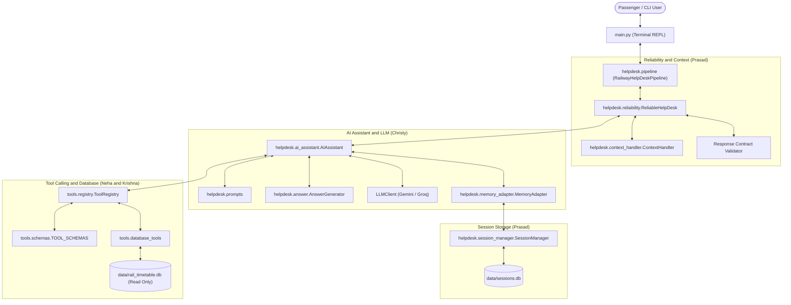

# 🚆 Railway Passenger Help Desk

**GenAI Nexus Fellowship · Module 2 Capstone Project**
**Team 5 (Neuroverse)**
**Repository:** `https://github.com/chxisty/genai-nexus-capstone-team-5`
**Active Branch:** `integration/railway-helpdesk-final`

---

## 1. Project Overview

The **Railway Passenger Help Desk** is an AI-powered conversational terminal application designed to answer passenger queries regarding Indian Railways. It combines Large Language Model (LLM) reasoning, schema-validated tool calling, a static SQLite timetable database, and persistent multi-turn session memory.

The system emphasizes **evidence grounding**, **data integrity**, and **zero hallucination**: answers are derived exclusively from verified tool executions against the local database, while unverified claims, live running statuses, PNR statuses, and unavailable policy documents are truthfully declined.

---

## 2. Problem Statement

Passengers inquiring about train schedules, routes, and station codes frequently face complex online portals or hallucinated outputs from generic AI chatbots. This project addresses the challenge by implementing a strictly bounded, tool-augmented railway help desk that:
1. Translates natural language passenger questions into structured tool invocations.
2. Retrieves verified railway schedule information from an official SQLite timetable snapshot.
3. Maintains conversational context across multiple turns using persistent session storage.
4. Detects ambiguous follow-up queries and requests clarification instead of guessing.
5. Strictly adheres to a verified 4-key JSON response contract (`answer`, `sources`, `sql`, `dont_know`).

---

## 3. Key Features

- **Schema-Validated Tool Calling:** Dispatches structured queries (`station_search`, `train_search`, `train_details`, `route_lookup`) through a strict registry enforcing type and argument constraints.
- **Real SQLite Timetable Integration:** Connects in URI read-only mode (`mode=ro`) to `data/rail_timetable.db` (5,208 trains, 8,990 stations) preventing accidental mutations.
- **Persistent Multi-Turn Sessions:** Backed by an independent SQLite database (`data/sessions.db`) allowing passengers to resume conversations, view session history (`/history`), or start fresh (`/new`).
- **Context-Aware Follow-Up Resolution:** Identifies pronouns, train references, and ambiguous context, asking clarifying questions when context is insufficient.
- **Multi-Provider LLM Support:** Seamlessly supports both Google Gemini (`gemini-3.5-flash` via `google-genai` SDK) and Groq (`openai/gpt-oss-120b` via `groq` SDK) with automatic exponential backoff retries.
- **Truthful Abstention & Safety:** Refuses write/delete SQL injections, live running status inquiries, fare calculations, and document policy questions when evidence is absent.

---

## 4. System Architecture



---

## 5. Team Module Responsibilities

| Team Member | Role & Module | Responsibilities & Core Files |
| :--- | :--- | :--- |
| **Member 1: Christy Marrya George** | AI Assistant & LLM Integration | Built `helpdesk/llm.py`, `helpdesk/prompts.py`, `helpdesk/answer.py`, `helpdesk/memory_adapter.py`, and `helpdesk/ai_assistant.py`. Supports Gemini & Groq with tool-calling orchestration and secret redaction. |
| **Member 2: Krishna Vinod** | Railway Database Tools | Authored `tools/database_tools.py`, verified `data/rail_timetable.db`, wrote `tests/test_database_tools.py`. Provides real SQLite queries with `mode=ro` protection. |
| **Member 3: Neha Santhosh** | Tool Calling & Schema Registry | Authored `tools/registry.py`, `tools/schemas.py`, and `tools/railway_tools.py`. Implemented validation envelopes (`{status, tool, result, error}`) and tool definitions. |
| **Member 4: Prasad Tribhuvan** | Context & Response Reliability | Authored `helpdesk/session_manager.py`, `helpdesk/context_handler.py`, `helpdesk/reliability.py`. Built persistent SQLite session storage and 4-field contract validation. |
| **Member 5: Ram Narisetti (Lead)** | Integration, Testing & Docs | Authored `main.py`, `helpdesk/pipeline.py`, `ask.py`, `tests/test_pipeline_integration.py`, `tests/test_cli.py`, `eval/railway_queries.txt`, and comprehensive documentation. |

---

## 6. Directory Structure

```text
genai-nexus-capstone-team-5/
├── main.py                             # Main interactive CLI application entry point
├── ask.py                              # Command-line utility shortcut
├── requirements.txt                    # Project dependencies
├── .env.example                        # Environment configuration template
├── .gitignore                          # Git exclusions (runtime db, venv, secrets)
├── README.md                           # Main project documentation
│
├── helpdesk/                           # Core helpdesk package
│   ├── __init__.py                     # Package export declarations
│   ├── pipeline.py                     # Central integrated pipeline wiring all components
│   ├── ai_assistant.py                 # Multi-step tool-calling assistant coordinator (Christy)
│   ├── llm.py                          # Dual-provider LLM client (Gemini / Groq) (Christy)
│   ├── prompts.py                      # System prompts & grounding instructions (Christy)
│   ├── answer.py                       # Grounded response synthesis & citation checks (Christy)
│   ├── memory_adapter.py               # Memory adapter bridging assistant & sessions (Christy)
│   ├── context_handler.py              # Follow-up and pronoun context analyzer (Prasad)
│   ├── session_manager.py              # Persistent SQLite session manager (Prasad)
│   └── reliability.py                  # ReliableHelpDesk wrapper & schema validator (Prasad)
│
├── tools/                              # Tool calling & database access
│   ├── __init__.py                     # Tools package exports
│   ├── registry.py                     # Central ToolRegistry with schema validation (Neha)
│   ├── schemas.py                      # OpenAI-format tool definitions (Neha)
│   ├── railway_tools.py                # Standalone mock tools for unit tests (Neha)
│   └── database_tools.py               # Production SQLite database functions (Krishna)
│
├── data/                               # Database directory
│   ├── rail_timetable.db               # Static 2016 Indian Railways SQLite snapshot (Krishna)
│   └── sessions.db                     # Runtime persistent session database (Prasad)
│
├── tests/                              # Automated test suite (129 tests)
│   ├── conftest.py                     # Global pytest fixtures
│   ├── test_pipeline_integration.py    # End-to-end integration test suite (Ram)
│   ├── test_cli.py                     # Command-line interface tests (Ram)
│   ├── test_ai_assistant.py            # AI assistant unit tests (Christy)
│   ├── test_llm.py                     # LLM client unit tests (Christy)
│   ├── test_answer.py                  # Answer generator unit tests (Christy)
│   ├── test_memory_adapter.py          # Memory adapter unit tests (Christy)
│   ├── test_prompts.py                 # Prompt generator unit tests (Christy)
│   ├── test_tools.py                   # Tool registry unit tests (Neha)
│   ├── test_database_tools.py          # Database tool unit tests (Krishna)
│   ├── test_context_handler.py         # Context analysis tests (Prasad)
│   ├── test_reliability.py             # Response validator tests (Prasad)
│   └── test_session_manager.py         # SQLite session manager tests (Prasad)
│
├── eval/                               # Evaluation & verification
│   └── railway_queries.txt             # Verified benchmark query logs across 8 categories
│
└── docs/                               # Detailed technical documentation
    ├── ARCHITECTURE.md                 # In-depth architectural specification
    ├── INTEGRATION_AUDIT.md            # Pre-integration audit report
    ├── TEST_PLAN.md                    # Detailed verification and testing strategy
    ├── TEST_RESULTS.md                 # Complete test run logs and metrics
    ├── DEMO_SCENARIOS.md               # 10 step-by-step interactive demo scenarios
    └── TEAM_INTEGRATION_STATUS.md      # Team branch coordination status
```

---

## 7. Prerequisites & Installation

### Prerequisites
- Python 3.10, 3.11, or 3.12 (Python 3.14 compatible)
- Git
- SQLite3

### Installation

1. **Clone the repository:**
   ```bash
   git clone https://github.com/chxisty/genai-nexus-capstone-team-5.git
   cd genai-nexus-capstone-team-5
   git checkout integration/railway-helpdesk-final
   ```

2. **Create and activate a virtual environment:**
   ```bash
   # Linux / macOS
   python3 -m venv .venv
   source .venv/bin/activate

   # Windows (PowerShell)
   python -m venv .venv
   .\.venv\Scripts\Activate.ps1
   ```

3. **Install dependencies:**
   ```bash
   pip install -r requirements.txt
   ```

4. **Configure environment variables:**
   Copy `.env.example` to `.env`:
   ```bash
   cp .env.example .env
   ```
   Add your Gemini or Groq API key:
   ```ini
   LLM_PROVIDER=gemini
   GEMINI_API_KEY=your_actual_gemini_api_key_here
   GEMINI_MODEL=gemini-3.5-flash
   ```

---

## 8. How to Run the Application

### A. Interactive Terminal REPL (Recommended)
Launch the full interactive console session:
```bash
python main.py
```

**Commands available in interactive mode:**
- `/help`: Display available commands.
- `/new`: Start a fresh conversation session with a new session ID.
- `/history`: Print the conversation history of the active session.
- `/exit` or `quit`: Cleanly exit the application.

### B. Single Question CLI Mode
Ask a direct question from the terminal and exit:
```bash
python main.py "Which trains are available from LTT to GWL?"
```
Or via the `ask.py` helper:
```bash
python ask.py "What are the details for train 01101?"
```

### C. JSON Output Mode
Output pure structured JSON conforming to the 4-field contract:
```bash
python ask.py --json "Search for New Delhi station"
```

---

## 9. Running the Automated Test Suite

Run all **129 tests** across the entire project:
```bash
python -m pytest -q
```

To run integration tests specifically:
```bash
python -m pytest tests/test_pipeline_integration.py -v
```

To run CLI tests:
```bash
python -m pytest tests/test_cli.py -v
```

---

## 10. Supported vs Unsupported Capabilities

| Question Category | Supported? | Behavior & Explanation |
| :--- | :---: | :--- |
| **Station Code & Name Search** | ✅ Yes | Queries SQLite `stations` table via `station_search`. |
| **Train Availability Between Stations** | ✅ Yes | Queries SQLite `schedules` and `trains` via `train_search`. |
| **Train Classes & Train Type Details** | ✅ Yes | Queries SQLite `trains` and `train_types` via `train_details`. |
| **Train Route & Sequential Halts** | ✅ Yes | Queries sequential station halts via `route_lookup`. |
| **Multi-turn Context & Follow-ups** | ✅ Yes | Managed by `ContextHandler` and stored in SQLite `sessions.db`. |
| **Refund & Cancellation Policy** | ❌ No | **No document RAG module in repo.** System truthfully declines with `dont_know: true` and `sources: []`. |
| **Tatkal Booking Regulations** | ❌ No | Truthfully declined due to absence of policy circular RAG engine. |
| **Live Train Running Status** | ❌ No | Static 2016 database snapshot; live delays are truthfully declined. |
| **Live PNR Status & Seat Availability** | ❌ No | PNR tracking is absent from the static database snapshot. |
| **Database Write / Mutating Queries** | ❌ No | Blocked. SQLite opened in URI read-only mode (`?mode=ro`). |

---

## 11. Example Terminal Session

```text
============================================
     RAILWAY PASSENGER HELP DESK
============================================

Welcome! Ask questions about Indian Railways.

Commands:
  /help    - Show available commands
  /new     - Start a new conversation
  /history - Show current session history
  /exit    - Exit application

You: Which trains are available from LTT to GWL?

Assistant:
Based on the railway timetable, there are 6 trains available from Lokmanya Tilak Terminus (LTT) to Gwalior (GWL), including:
- Train 01101 (Mumbai LTT - Gwalior Special)
- Train 01127 (Mumbai LTT - Gwalior Special)
- Train 11079 (Mumbai LTT - Gorakhpur Express)
- Train 12137 (Punjab Mail)
- Train 12171 (Mumbai LTT - Haridwar AC Superfast Express)

Sources:
None (No official document cited)

SQL:
null

You: What are the stops for train 01101?

Assistant:
Train 01101 (Mumbai LTT - Gwalior Special) departs from Lokmanya Tilak Terminus (LTT) and halts at Thane, Kalyan, Igatpuri, Nasik Road, Manmad, Jalgaon, Bhusaval, Khandwa, Itarsi, Bhopal, Bina, Jhansi, and reaches Gwalior (GWL).

Sources:
None (No official document cited)

SQL:
null

You: /history

--- Session History (sess_9d2f4a1e0b) ---
[User]: Which trains are available from LTT to GWL?
[Assistant]: Based on the railway timetable, there are 6 trains available from Lokmanya Tilak Terminus (LTT) to Gwalior (GWL)...
[User]: What are the stops for train 01101?
[Assistant]: Train 01101 (Mumbai LTT - Gwalior Special) departs from Lokmanya Tilak Terminus (LTT)...
----------------------------------------

You: /exit

Thank you for using Railway Passenger Help Desk!
```

---

## 12. Known Limitations & Technical Notes

1. **Static 2016 Timetable Snapshot:** The database represents historical schedules from August 2016. Recent train launches (such as Vande Bharat Express routes) are not in the SQLite database.
2. **Absence of Document Ingestion / RAG:** As verified during Phase 1 audit, policy document search modules were not authored by teammates. The application enforces honest abstentions (`dont_know: true`, `sources: []`) for policy rules.
3. **Database Write Protection:** The application uses read-only SQLite connections, guaranteeing that user input cannot alter or delete timetable data.
