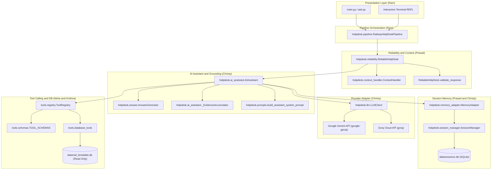
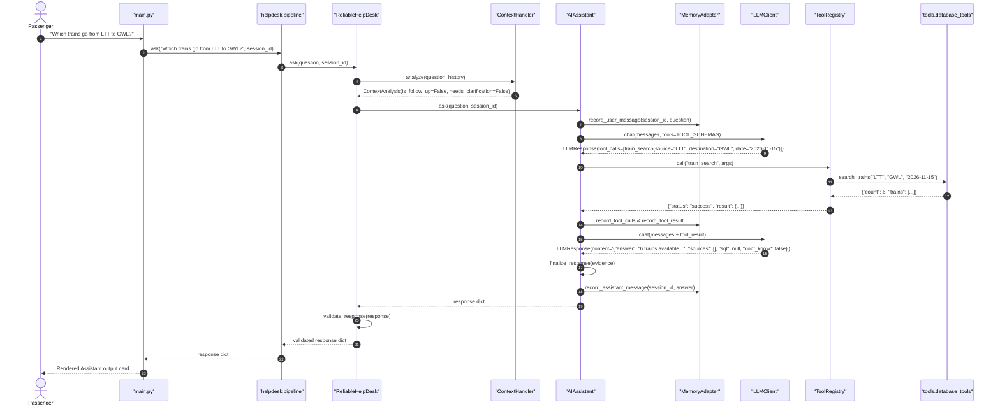
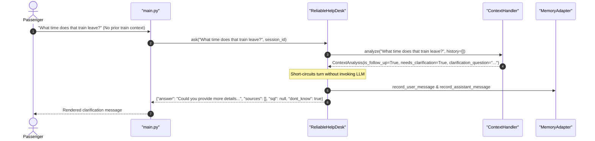

# System Architecture: Railway Passenger Help Desk

**GenAI Nexus Fellowship · Module 2 Capstone**  
**Team 5 (Neuroverse)**  
**Integration Lead:** Ram Narisetti (Member 5)

---

## 1. Architectural Overview

The Railway Passenger Help Desk is engineered as a multi-tier, modular AI assistant that couples conversational LLM reasoning with deterministic tool calling and local SQLite persistence. The architecture prioritizes **grounding**, **loose coupling via protocols**, **defensive reliability**, and **zero hallucination**.

### High-Level Component Topology

---

## 2. Component Specifications & Protocol Boundaries

### 2.1 Presentation & Pipeline Layer (`main.py`, `helpdesk/pipeline.py`)
- **Owner:** Member 5 (Ram Narisetti)
- **Role:** Central entry point that coordinates runtime initialization.
- **Key Responsibilities:**
  - Instantiates `ToolRegistry` and registers real SQLite database tools.
  - Instantiates SQLite `SessionManager` and injects it into `MemoryAdapter`.
  - Configures `AIAssistant` with multi-step tool limits (`max_tool_steps=5`).
  - Wraps assistant with `ReliableHelpDesk` to guarantee response contract conformance.
  - Implements the terminal REPL with session preservation, `/help`, `/new`, `/history`, and `/exit`.

### 2.2 Reliability & Context Management (`helpdesk/context_handler.py`, `helpdesk/reliability.py`)
- **Owner:** Member 4 (Prasad Tribhuvan)
- **Role:** Defensive wrapper intercepting incoming queries and outgoing responses.
- **Key Responsibilities:**
  - `ContextHandler.analyze(question, history)`: Analyzes question text using regex heuristics (`^what about`, `^and`, `\bthat train\b`) to detect follow-ups. Extracts mentioned train numbers from conversation history.
  - Ambiguity Detection: If a follow-up query is issued without sufficient context (or refers to multiple ambiguous trains without selection), generates a clarification request without calling the LLM.
  - `ReliableHelpDesk.validate_response(result)`: Enforces the strict 4-field contract:
    - `answer`: Non-empty `str`.
    - `sources`: `list[dict]` where each item has `doc: str` and `page: int | None`.
    - `sql`: `str` or `None`.
    - `dont_know`: `bool`.

### 2.3 AI Assistant & Grounding (`helpdesk/ai_assistant.py`, `helpdesk/answer.py`, `helpdesk/prompts.py`)
- **Owner:** Member 1 (Christy Marrya George)
- **Role:** Multi-step tool-calling agent, context assembler, and grounded response synthesizer.
- **Key Responsibilities:**
  - Builds grounded system prompts establishing assistant identity and 2016 static timetable bounds.
  - Coordinates multi-turn LLM reasoning loops: when the LLM requests a tool call, dispatches to `ToolRegistry` and passes the result back as a `tool` message.
  - `_EvidenceAccumulator`: Collects and verifies all tool outputs (stations, trains, stops, SQL queries).
  - Grounded Answer Synthesis: If no verified tool evidence exists, enforces a truthful refusal (`dont_know: true`, `sources: []`), preventing ungrounded speculation.
  - Secret Redaction: Scrubs API keys and bearer tokens from logs and error messages using `redact_secrets`.

### 2.4 Multi-Provider LLM Client (`helpdesk/llm.py`)
- **Owner:** Member 1 (Christy Marrya George)
- **Role:** Unified provider adapter for Gemini and Groq.
- **Key Responsibilities:**
  - Dual Provider Support: Google Gemini (`gemini-3.5-flash` via `google-genai` SDK) and Groq (`openai/gpt-oss-120b` via `groq` SDK).
  - Resilient Retries: Decorates network calls with exponential backoff for rate limits (HTTP 429) and transient connection failures.
  - Gemini 3.x `thought_signature` caching: Replays internal reasoning signatures across multi-step function call turns.
  - Error Hierarchy: Translates vendor exceptions into domain errors (`LLMAuthError`, `LLMRateLimitError`, `LLMTimeoutError`, `LLMConnectionError`).

### 2.5 Session Storage (`helpdesk/session_manager.py`, `helpdesk/memory_adapter.py`)
- **Owner:** Member 4 (Prasad Tribhuvan) & Member 1 (Christy Marrya George)
- **Role:** Persistent conversation history across session turns.
- **Key Responsibilities:**
  - `SessionManager`: SQLite-backed storage (`data/sessions.db`) using foreign-keyed tables `sessions` and `messages`.
  - `MemoryBackendProtocol`: Protocol defining `create_session`, `has_session`, `get_history`, `add_message`, `clear_session`.
  - `MemoryAdapter`: Normalizes message roles, performs conservative token estimation (~4 characters per token), and prunes oldest turns when exceeding the context budget while preserving system framing.

### 2.6 Tool Registry & Railway Database Tools (`tools/`)
- **Owner:** Member 3 (Neha Santhosh) & Member 2 (Krishna Vinod)
- **Role:** Schema-driven tool dispatch and SQLite timetable execution.
- **Key Responsibilities:**
  - `tools.schemas.TOOL_SCHEMAS`: Standardized OpenAI-format JSON schemas (`station_search`, `train_search`, `train_details`, `route_lookup`).
  - `tools.registry.ToolRegistry`: Validates argument types, required fields, and non-empty strings before dispatch. Enforces uniform return envelope: `{"status": "success"|"error", "tool": name, "result": data, "error": msg}`.
  - `tools.database_tools`: Production database tool implementations querying `data/rail_timetable.db` in URI read-only mode (`file:...rail_timetable.db?mode=ro`).

---

## 3. End-to-End Execution Sequence Diagrams

### 3.1 Normal Database-Backed Query Flow

---

### 3.2 Ambiguous Follow-Up Clarification Flow (No LLM Call)

---

## 4. Security, Isolation & Safety Controls

1. **Read-Only Database Connection:**
   `tools.database_tools.get_connection()` opens `rail_timetable.db` using SQLite URI `mode=ro`. Any attempt to execute `INSERT`, `UPDATE`, `DELETE`, or `DROP` raises `sqlite3.OperationalError: attempt to write a readonly database`.
2. **Secret Redaction:**
   All logging pipelines pass through `redact_secrets()`, automatically masking Google API keys (`AIza...`), Groq API keys (`gsk_...`), Bearer tokens, and known configuration keys.
3. **No Unbounded Memory Growth:**
   `MemoryAdapter` enforces maximum context messages (`max_context_messages=20`) and total token budgets (`max_context_tokens=4000`), trimming oldest user/assistant turns while maintaining system prompt continuity.
4. **Zero Document RAG Hallucination:**
   Because document search tools are not present in the repository, any query demanding document policy rules (refund rules, Tatkal percentages) results in `dont_know: True` and empty sources (`[]`), preventing the fabrication of nonexistent circulars or pages.
