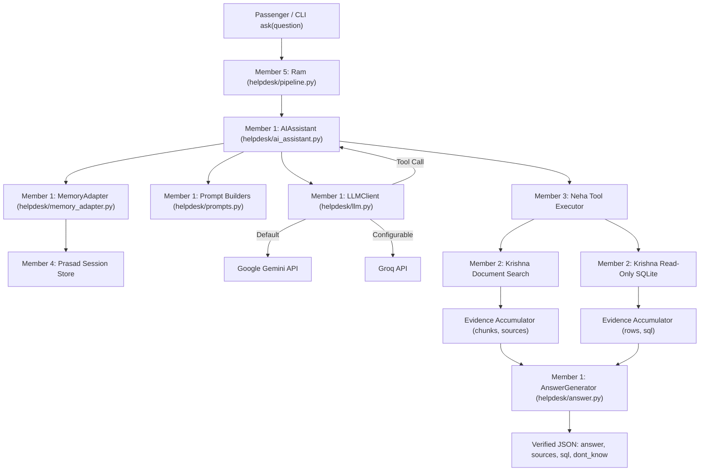
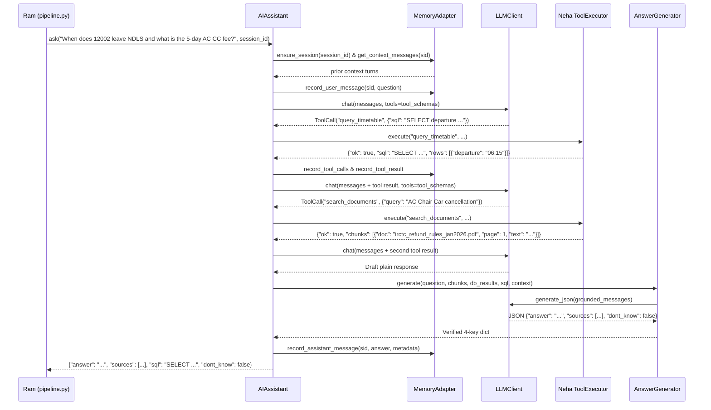
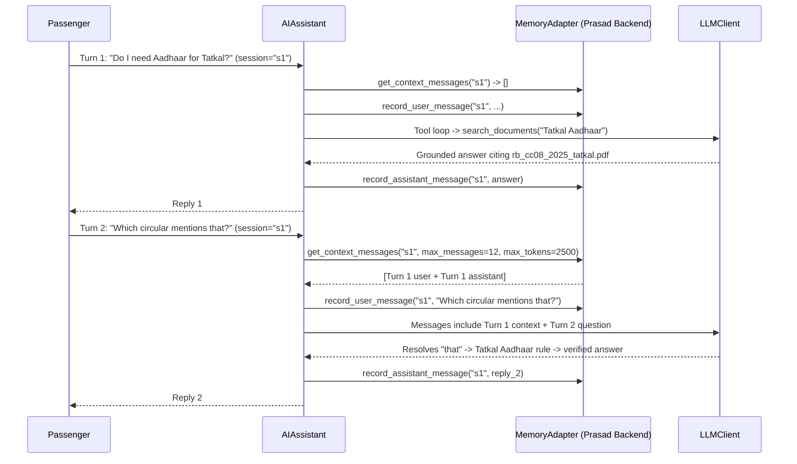
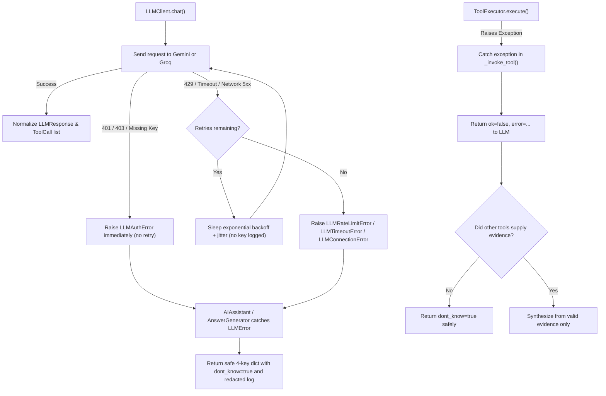

# Christy's Workflow & Architecture Guide — Railway Passenger Help Desk

This document traces the complete execution lifecycle, data flow, tool-calling loop, multi-turn memory integration, error recovery, and cross-team interfaces for Member 1's AI Assistant module.

---

## 1. High-Level Architecture Diagram

---

## 2. End-to-End Execution Data Flow

1. **Entry (`AIAssistant.ask` / `process_question`)**:
   - Validates that `question` is non-empty.
   - Calls `MemoryAdapter.ensure_session(session_id)` to resolve or initialize a session ID.
   - Fetches prior context via `MemoryAdapter.get_context_messages(sid)` within message-count and token budgets.
   - Records the current passenger message with `MemoryAdapter.record_user_message(...)`.
2. **Prompt Construction (`helpdesk/prompts.py`)**:
   - Composes the system prompt from modular components (`ROLE_IDENTITY_PROMPT`, `EVIDENCE_GROUNDING_PROMPT`, `RULE_PRECEDENCE_PROMPT`, `TIMETABLE_SCOPE_PROMPT`, `MISSING_AND_CONFLICT_PROMPT`, `CITATION_INTEGRITY_PROMPT`, `TOOL_USAGE_PROMPT`).
   - Appends bounded prior conversation turns and the current passenger question.
3. **Multi-Step Tool-Calling Loop (`helpdesk/ai_assistant.py` + `helpdesk/llm.py`)**:
   - Calls `LLMClient.chat(messages, tools=tool_schemas)` up to `max_tool_steps` iterations.
   - `LLMClient` translates OpenAI-style schemas and `tool` history into `google.genai.types` (`Tool`, `FunctionDeclaration`, `Content`, `Part` with Gemini 3.x `thought_signature` preservation) when using Gemini, or passes them directly when using Groq.
   - If the LLM emits `ToolCall` requests, `AIAssistant._invoke_tool` executes each tool safely via Neha's `tool_executor` (which routes to Krishna's document search or read-only SQLite DB).
   - `_collect_evidence_from_tool_result` captures normalized document chunks, source `(doc, page)` pairs, DB rows, and executed `SELECT` SQL strings.
   - Tool calls and tool results are recorded in `MemoryAdapter` and fed back into `messages` so the LLM can either perform additional lookups (e.g., hybrid schedule + refund question) or complete reasoning.
4. **Grounded Answer Synthesis & Validation (`helpdesk/answer.py`)**:
   - If zero usable evidence was retrieved:
     - Explicit refusal text (e.g., refusing a database modification request) is preserved with `dont_know=True`.
     - Any ungrounded factual claim made without evidence is blocked and replaced with `"I don't know..."` (`dont_know=True`, `sources=[]`, `sql=None`).
   - If evidence exists:
     - `AnswerGenerator` builds grounded messages (or validates direct JSON) and filters citations strictly against the retrieved `(doc, page)` allowlist.
     - HTML documents always normalize `page` to `None`.
     - `sql` is locked to the actual executed SQL string(s), never LLM-generated SQL.
5. **Memory Persistence & Return**:
   - Records the final assistant answer and grounding metadata in `MemoryAdapter`.
   - Returns `{"answer": ..., "sources": ..., "sql": ..., "dont_know": ...}`.

---

## 3. Function-Call & Hybrid Tool-Calling Sequence

---

## 4. Multi-Turn Conversation Sequence

---

## 5. Error-Handling & Retry Sequence

---

## 6. Integration Summary Across All Five Members

| Member | Responsibility | How Christy's Module Connects |
| :--- | :--- | :--- |
| **1. Christy (Me)** | LLM client, prompts, grounded answers, AI tool loop, memory adapter | Owns `llm.py`, `prompts.py`, `answer.py`, `memory_adapter.py`, `ai_assistant.py`. |
| **2. Krishna** | SQLite DB (`rail_timetable.db`), station/train queries, document search | Provides chunks (`doc`, `page`, `date`, `text`) and read-only SQL outputs (`sql`, `rows`) surfaced via tools. |
| **3. Neha** | Tool schemas, argument validation, query routing, tool execution | Supplies OpenAI-style `tool_schemas` and `ToolRegistry.call(name, args)` (or `.execute`) injected into `AIAssistant`. |
| **4. Prasad** | Session store, conversation storage, response reliability | Supplies session store matching `MemoryBackendProtocol` injected into `MemoryAdapter(backend=...)`. |
| **5. Ram** | `pipeline.py`, `ask(question)`, CLI runners, evaluation, main README | Instantiates `AIAssistant` with all team components and delegates `ask(question)` calls to it. |

---

## 7. Step-by-Step Technical Evaluation Walkthrough

When demonstrating Member 1 during the live presentation or viva, walk through these 5 steps:

1. **Multi-Provider Initialization (`helpdesk/llm.py`):** Show `.env.example` and explain how `LLMConfig.from_env()` defaults to Gemini (`gemini-3.5-flash` via `google-genai`) for capstone evaluation while allowing instant switching to Groq (`openai/gpt-oss-120b`) via `LLM_PROVIDER=groq`.
2. **Modular System Prompts (`helpdesk/prompts.py`):** Point out how `build_assistant_system_prompt()` composes evidence-only grounding, circular date precedence, and the 2016 snapshot scope without embedding any test answers.
3. **Tool-Calling Loop (`helpdesk/ai_assistant.py`):** Explain how `AIAssistant.process_question()` runs up to `max_tool_steps`, dispatches calls to Neha's `ToolRegistry.call()`, unwraps `{"status": "success", "result": ...}`, and collects evidence across multiple tools.
4. **Memory Budgeting (`helpdesk/memory_adapter.py`):** Explain how `MemoryAdapter` connects to Prasad's session store via `MemoryBackendProtocol`, enforces `max_messages` and `max_tokens`, and groups `assistant(tool_calls)` + `tool` pairs atomically.
5. **Grounded Validation (`helpdesk/answer.py`) & Verification (`pytest`):** Show how `AnswerGenerator` validates `(doc, page)` citations against an allowlist, normalizes HTML pages to `null`, locks `sql` to real executed SQL only, and run `.\.venv\Scripts\python.exe -m pytest -v` to demonstrate all 50 unit tests passing.

